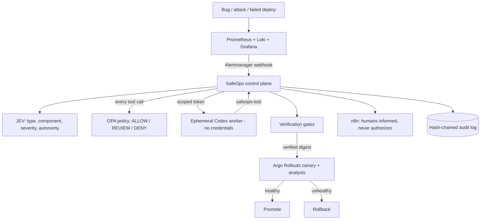

# Architecture

| Control plane (decides) | Execution plane (acts, holds no authority) |
|---|---|
| JEV decision, policy evaluation, approvals | Codex investigation in an isolated container |
| Grants, tokens, audit, circuit breaker | Reading logs/metrics through the gateway only |
| Verification gates, deployment authorization | Writing a patch in its own workspace |
